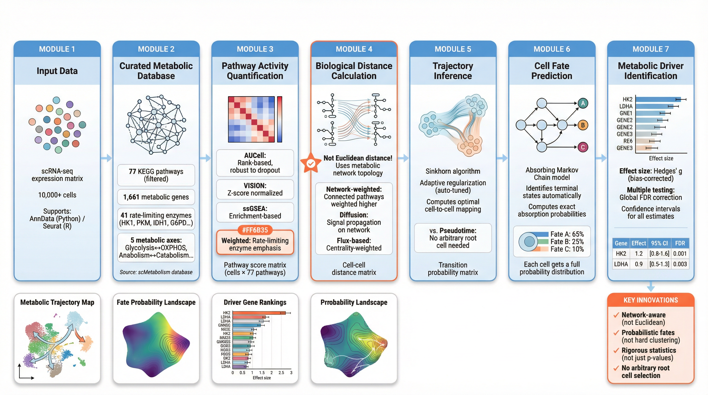

# MetaTrajectory

**Optimal Transport-Based Metabolic Trajectory Analysis for Single-Cell Data**

[](https://www.python.org/downloads/)
[](https://www.r-project.org/)

A mathematically rigorous framework for analyzing metabolic state transitions in single-cell RNA-seq data using optimal transport theory.

## Overview



## Key Features

| Feature | Description |
|---------|-------------|
| **Advanced Scoring** | AUCell, VISION, ssGSEA, weighted methods |
| **Rigorous Statistics** | Cohen's d, Hedges' g, global FDR, Bayes factors |
| **Network Distance** | Topology-aware metabolic distances |
| **Adaptive Parameters** | Automatic regularization selection |
| **Benchmarking** | Systematic comparison framework |
| **Validation** | Synthetic ground truth verification |
| **77 KEGG Pathways** | Scientifically filtered pathway database |

## Why MetaTrajectory?

1. **Mathematical Rigor**: Uses optimal transport instead of pseudo-dynamics - no circular reasoning
2. **Network-Constrained**: Leverages KEGG metabolic network topology for biologically meaningful distances
3. **Multi-Layer Integration**: Integrates with RNA velocity to provide metabolic interpretation
4. **Fate Probability**: Computes probability of transitioning to different metabolic terminal states
5. **Driver Identification**: Identifies key metabolic enzymes driving fate decisions

## Installation

### Python

```bash
cd python
pip install -e .
```

### R

```r
# Install dependencies
install.packages(c("transport", "igraph", "Seurat", "ggplot2"))

# Install MetaTrajectory
devtools::install("R/")
```

## Quick Start

### Python

```python
import scanpy as sc
import metatrajectory as mt

# Load data
adata = sc.read_h5ad("your_data.h5ad")

# Build knowledge base (77 filtered KEGG pathways)
kb = mt.MetabolicKnowledgeBase()
kb.load_kegg_pathways()

# Compute metabolic state space
mss = mt.MetabolicStateSpace(kb)
mss.fit(adata)

# Optimal transport trajectory inference
mot = mt.MetabolicOT(mss)
source_cells = adata.obs['timepoint'] == 'early'
target_cells = adata.obs['timepoint'] == 'late'
mot.compute_cost_matrix(source_cells=source_cells, target_cells=target_cells)
mot.compute_transport_plan()
mot.compute_transition_matrix(adata)

# Identify terminal states and fate probabilities
terminal_states = mss.identify_terminal_states(n_clusters=3)
mot.compute_fate_probabilities(terminal_states)

# Identify driver genes with rigorous statistics
drivers = mt.DriverAnalysis(mot, mss, kb)
drivers.fit(adata)
driver_genes = drivers.get_top_drivers(n_top=20)

# Apply global FDR correction
driver_genes = mt.global_fdr_correction(driver_genes)

# Visualize
mt.plot_metabolic_landscape(adata, mss)
mt.plot_fate_probabilities(adata, mot)
mt.plot_driver_genes(drivers.fate_drivers)
```

### R

```r
library(MetaTrajectory)
library(Seurat)

# Load data
seurat_obj <- readRDS("your_data.rds")

# Build metabolic knowledge base (77 filtered KEGG pathways)
kb <- build_metabolic_graph()

# Compute pathway scores with advanced methods
scores <- compute_pathway_scores_advanced(seurat_obj, kb, method = "weighted")

# Metabolic state space with PCA embedding
mss <- metabolic_state_space(seurat_obj, kb, n_pcs = 20)

# Optimal transport
source_cells <- which(seurat_obj$timepoint == "early")
target_cells <- which(seurat_obj$timepoint == "late")
ot_result <- optimal_transport(mss$embedding[source_cells, ], mss$embedding[target_cells, ])

# Transition matrix and fate probabilities
trans <- compute_transition_matrix(mss$embedding, k = 30)
terminal_states <- identify_terminal_states(seurat_obj, scores, n_terminal = 3)
fate_probs <- compute_fate_probabilities(trans, terminal_states)

# Driver genes with rigorous statistics
drivers <- find_driver_genes(seurat_obj, source_cells, target_cells, kb)
drivers <- global_fdr_correction(drivers)

# Visualize
plot_metabolic_landscape(seurat_obj, mss)
plot_driver_genes(drivers)
```

## Core Concepts

### Why Optimal Transport?

Traditional trajectory methods assume:
- Continuous developmental paths
- Pseudo-time ordering based on graph distances

**Problems**:
- Circular reasoning (define direction, then validate with direction)
- No real time information

**Optimal Transport provides**:
- Mathematically rigorous framework for distribution matching
- No assumption of continuous trajectories
- Probabilistic interpretation of cell fate

### Metabolic Network Constraints

We use KEGG metabolic network to:
- Define biologically meaningful distances between metabolic states
- Constrain the state space to feasible metabolic transitions
- Identify rate-limiting enzymes as potential drivers

## Citation

If you use MetaTrajectory in your research, please cite:

```
MetaTrajectory: Optimal Transport-Based Metabolic Trajectory Analysis
for Single-Cell Data (2026)
```

## License

MIT License
